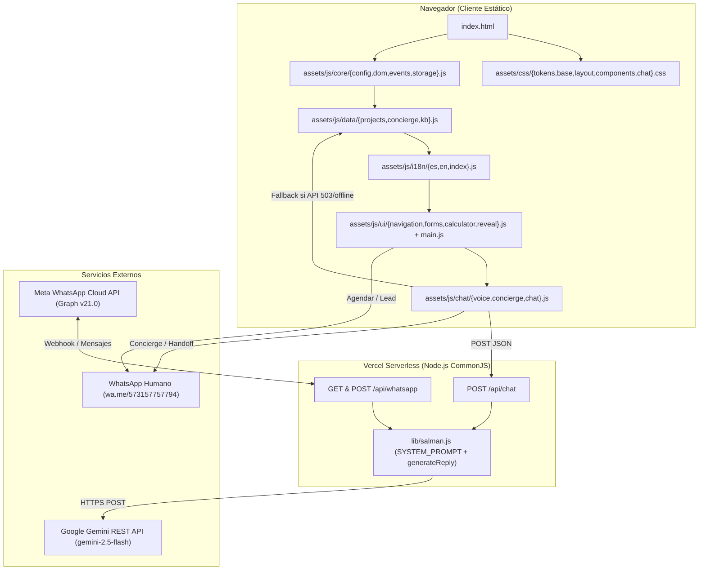

# Documentación Técnica y Funcional — SALMAN Web v2

- **Proyecto:** SALMAN Constructora + Inmobiliaria S.A.S. (Cartagena de Indias, Colombia)
- **Dueño del proyecto:** Gerencia SALMAN Constructora + Inmobiliaria S.A.S. (`SalmanSAS.gerencia@gmail.com`)
- **Estado del documento:** Producción / Refactor completado (Fases 0 a 4 verificadas)
- **Última actualización:** 2026-10-25
- **Rama de trabajo:** `refactor/orden-codigo` (línea base en tag `pre-refactor`, commit `6394c59`)

---

## 1. Resumen del negocio y del sitio

**SALMAN Constructora + Inmobiliaria S.A.S.** estructura, diseña, construye y comercializa proyectos residenciales y turísticos en Cartagena de Indias, Colombia, integrando bajo un mismo equipo:
1. **Constructora:** gestión integral de proyectos, diseño arquitectónico, diseño urbano, interventoría y auditorías, visualización 3D y consultoría 360°.
2. **Inmobiliaria:** búsqueda y acompañamiento, evaluación y diagnóstico técnico, análisis normativo, evaluación jurídica, evaluación financiera y estructuración de compra.

El sitio web (`salman-web-v2-completo`) es una **landing comercial bilingüe (ES/EN)** de alto perfil editorial que incluye:
- Presentación del proyecto insignia (*Marina Cangrejo Azul*) y portafolio filtrable de 4 proyectos (*Marina Cangrejo Azul*, *Torres Bocagrande*, *Casa Club Punta Arena*, *Residencias Mar Abierto*).
- Acceso a preventa privada **Lista Cero (VIP)**.
- **Calculadora financiera** interactiva con amortización francesa.
- **Formularios de captura de leads y agendamiento de visitas** conectados a WhatsApp (`+57 315 775 7794`) con consentimiento de Habeas Data (Ley 1581 de 2012).
- **Salma (Asesora Digital con IA):** chat flotante bilingüe con soporte de voz (Web Speech API: `SpeechRecognition` + `speechSynthesis`), conectado a Google Gemini (`gemini-2.5-flash`) mediante `/api/chat` y con motor local de respaldo (*fallback* por coincidencia de palabras clave sobre `KB`).
- **Pestaña Concierge:** derivación directa a WhatsApp (`https://wa.me/573157757794`) por área de atención (5 rutas humanas) y validación humana de código VIP.
- **Webhook de WhatsApp Cloud API (`/api/whatsapp`):** integración serverless con Meta Graph API que comparte el cerebro `lib/salman.js`.

> **Advertencia sobre datos del prototipo:** Los nombres de proyectos, precios, áreas, fechas de entrega y porcentajes vendidos en la capa de datos del cliente (`assets/js/data/projects.js` y `assets/js/data/kb.js`) son **contenido ilustrativo de demostración**. En el backend (`lib/salman.js`), el modelo tiene prohibido citar precios, áreas, disponibilidad o condiciones crediticias no verificadas.

---

## 2. Stack y arquitectura

| Capa | Tecnología | Detalles |
|---|---|---|
| **Frontend** | HTML5, CSS3 por capas, JavaScript Vanilla modular (ES2020+) | Sin frameworks (React/Vue), sin bundlers (Webpack/Vite) ni pasos de compilación (*zero build step*). |
| **Voz en navegador** | Web Speech API | `SpeechRecognition` / `webkitSpeechRecognition` (STT) y `window.speechSynthesis` (TTS) en `es-CO` y `en-US` (`assets/js/chat/voice.js`). |
| **Persistencia cliente** | Web Storage API | `localStorage` (`salman.lang`) y `sessionStorage` (`salman.chat.v1`, `salman.lead`) encapsulados en `assets/js/core/storage.js`. |
| **Analítica** | `window.dataLayer` | Eventos estándar listos para Google Tag Manager / GA4 (`assets/js/core/events.js`). |
| **Backend Serverless** | Vercel Functions (Node.js CommonJS) | `api/chat.js` y `api/whatsapp.js` consumiendo `lib/salman.js`. |
| **IA Generativa** | Google Gemini REST API (`v1beta`) | Modelo por defecto: `gemini-2.5-flash` vía `fetch` nativo con `AbortController` (timeout 20 s). |
| **Mensajería** | WhatsApp Links (`wa.me/573157757794`) + WhatsApp Cloud API | Enlaces directos desde UI/Concierge y webhook Graph API (`v21.0` por defecto) en `/api/whatsapp`. |

### Diagrama de arquitectura



---

## 3. Árbol de archivos y responsabilidad de cada carpeta

```text
salman-web-v2-completo/
├─ index.html                  # Documento principal (landing + modales + chat + sprite SVG)
├─ DOCUMENTACION.md            # Documentación técnica y funcional completa (este archivo)
├─ README.md                   # Guía rápida de ejecución, despliegue y enlaces
├─ CHANGELOG.md                # Registro de cambios por fase y commit
├─ LEEME-PRIMERO.md            # Nota original de entrega del paquete
├─ vercel.json                 # Cabeceras HTTP (X-Robots-Tag: noindex, nofollow) y redirecciones (/wa, /asesor)
├─ site.webmanifest            # Manifiesto PWA básico
├─ robots.txt                  # Reglas para crawlers y referencia a sitemap
├─ sitemap.xml                 # Mapa XML del sitio
├─ .env.example                # Plantilla de variables de entorno (sin secretos)
├─ .gitignore                  # Exclusiones de Git (.env*, node_modules, .vercel)
├─ .vercelignore               # Exclusiones de despliegue en Vercel (*.md, start-demo.cmd, .env*)
├─ start-demo.cmd              # Script Windows para levantar servidor HTTP local con Python (puerto 8080)
├─ assets/                     # Recursos estáticos públicos
│  ├─ css/                     # Hojas de estilo organizadas por capas
│  │  ├─ tokens.css            # Variables CSS en :root (paleta, tipografía, sombras, radios)
│  │  ├─ base.css              # Reset, elementos base, tipografía editorial, utilidades, reveal y reduced-motion
│  │  ├─ layout.css            # Header, menú móvil, Hero, secciones, footer, mobile bar y media queries
│  │  ├─ components.css        # Botones, galería, filtros, project-cards, calculadora, FAQ, formularios y modales
│  │  └─ chat.css              # FAB, panel de chat, tabs, Concierge, VIP, mensajes, chips y modo voz
│  ├─ js/                      # Módulos JavaScript vanilla
│  │  ├─ core/                 # Núcleo transversal y utilidades compartidas
│  │  │  ├─ config.js          # CONFIG corporativo, teléfono oficial (+57 315 775 7794) y helper WA()
│  │  │  ├─ dom.js             # Helpers DOM ($, $$, esc, num, money, openDialog, closeDialog, initDials, showToast)
│  │  │  ├─ events.js          # Telemetría dataLayer (track) y bus de cambio de idioma (salman:lang)
│  │  │  └─ storage.js         # Persistencia segura en localStorage y sessionStorage
│  │  ├─ data/                 # Modelos de datos estáticos e ilustrativos
│  │  │  ├─ projects.js        # PROJECTS (4 proyectos), SERVICES (Constructora/Inmobiliaria), FAQ (8) y projectName()
│  │  │  ├─ concierge.js       # CONCIERGE (5 rutas humanas: comercial, diseno, gerencia, vip, orientacion)
│  │  │  └─ kb.js              # KB (22 entradas bilingües de respaldo local para Salma)
│  │  ├─ i18n/                 # Internacionalización ES/EN
│  │  │  ├─ es.js              # Diccionario TEXT_ES (239 claves en español)
│  │  │  ├─ en.js              # Diccionario TEXT_EN (239 claves en inglés)
│  │  │  └─ index.js           # LANG_META, t(), tf() y applyLanguage()
│  │  ├─ ui/                   # Componentes interactivos de la landing
│  │  │  ├─ navigation.js      # Header, menú móvil, proyectos, filtros, galería insignia, modal y delegación
│  │  │  ├─ forms.js           # Validación, modal de lead (#leadForm) y formulario de agenda (#bookingForm)
│  │  │  ├─ calculator.js      # Calculadora financiera interactiva (amortización francesa)
│  │  │  └─ reveal.js          # Animaciones de entrada con IntersectionObserver ([data-reveal], [data-progress])
│  │  ├─ chat/                 # Asesora digital Salma, Voz y Concierge
│  │  │  ├─ voice.js           # Reconocimiento (SpeechRecognition) y síntesis de voz (speechSynthesis)
│  │  │  ├─ concierge.js       # Renderizado y acciones del Concierge (renderConcierge, setChatTab, openArea, openVIP)
│  │  │  └─ chat.js            # Orquestador del chat, historial, cliente /api/chat, motor KB local, lead y handoff
│  │  └─ main.js               # Punto de entrada de la aplicación, query params y API pública window.SALMAN
│  └─ img/                     # 18 activos gráficos en uso (.webp, .svg, .jpg)
├─ api/                        # Funciones Serverless en Vercel (CommonJS)
│  ├─ chat.js                  # Endpoint POST /api/chat con rate-limit en memoria
│  └─ whatsapp.js              # Endpoint GET/POST /api/whatsapp (webhook de Meta Cloud API + HMAC opcional)
├─ lib/                        # Lógica compartida de backend
│  └─ salman.js                # Prompt de sistema, reglas duras, sanitización de historial y cliente Gemini REST
└─ docs/                       # Entregables de ingeniería, auditoría y arquitectura
   ├─ PROJECT-CONTEXT.md       # Contexto funcional, comercial y restricciones
   ├─ BASELINE.md              # Línea base técnica y funcional (Fase 0)
   ├─ AUDITORIA-CODIGO.md      # Auditoría completa antes y después del refactor
   ├─ ARCHITECTURE.md          # Arquitectura detallada de capas y contratos
   ├─ REFACTOR-PLAN.md         # Plan de refactorización ejecutado
   ├─ MIGRATION-MAP.md         # Mapa trazable de migración archivo por archivo
   ├─ TEST-REPORT.md           # Reporte de pruebas automatizadas y E2E (Fase 0 y Fase 4)
   └─ RISKS.md                 # Matriz de riesgos y mitigaciones
```

---

## 4. Cómo ejecutar en local

### Opción A: Script incluido (Python 3)
1. Ejecutar `start-demo.cmd` (doble clic o desde terminal en Windows):
   ```powershell
   .\start-demo.cmd
   ```
2. Abre automáticamente `http://localhost:8080/`.
   - **Nota:** Con un servidor estático simple (`python -m http.server`), la ruta `/api/chat` no existe localmente y devuelve `404`/`501`, por lo que `assets/js/chat/chat.js` activa de forma transparente el **modo fallback local (`KB`)** sin romper la experiencia. El modo voz (`SpeechRecognition`) funciona porque `localhost` es un contexto seguro.

### Opción B: Vercel CLI (para probar funciones `/api/chat` y `/api/whatsapp`)
1. Copiar `.env.example` a `.env.local` y completar `GEMINI_API_KEY`.
2. Ejecutar:
   ```powershell
   npx vercel dev
   ```

---

## 5. Variables de entorno

Definidas en `.env.example` y configurables en **Vercel → Settings → Environment Variables**:

| Variable | Obligatoria | Valor por defecto | Descripción |
|---|---|---|---|
| `GEMINI_API_KEY` | Sí (para IA en vivo) | — | Clave de API de Google AI Studio (`AIza...`). También acepta `GOOGLE_API_KEY` como alias en `lib/salman.js`. |
| `GEMINI_MODEL` | No | `gemini-2.5-flash` | Modelo de Gemini utilizado para generar respuestas. No cambiar sin justificación técnica/comercial. |
| `WHATSAPP_TOKEN` | Sí (para webhook WA) | — | Token Bearer de Meta WhatsApp Cloud API (System User o temporal). |
| `WHATSAPP_PHONE_NUMBER_ID` | Sí (para webhook WA) | — | Identificador numérico del teléfono en Meta Cloud API (no es el número telefónico). |
| `WHATSAPP_VERIFY_TOKEN` | Sí (para webhook WA) | `salman-demo-2026` (ejemplo) | Cadena secreta definida por el administrador para validar el reto `GET /api/whatsapp`. |
| `WHATSAPP_APP_SECRET` | Recomendada en prod | — | Secreto de aplicación de Meta para verificar la firma criptográfica `X-Hub-Signature-256` en `POST /api/whatsapp`. |
| `WHATSAPP_API_VERSION` | No | `v21.0` | Versión del Graph API de Meta. |

> **Seguridad:** Ninguna clave vive en el código fuente ni en el repositorio Git. `.gitignore` y `.vercelignore` bloquean cualquier archivo `.env*`.

---

## 6. Cómo desplegar en Vercel

1. Subir el repositorio a GitHub/GitLab/Bitbucket y conectarlo como proyecto en Vercel (Root Directory: `./`).
2. Framework Preset: **Other** (sin comando de build, Output Directory por defecto).
3. En **Settings → Environment Variables**, registrar `GEMINI_API_KEY`, `GEMINI_MODEL=gemini-2.5-flash` y las variables `WHATSAPP_*`.
4. Desplegar a producción y verificar:
   - `GET https://<dominio>/` carga la landing.
   - `GET https://<dominio>/api/chat` responde `405 {"error":"method_not_allowed"}`.
   - `POST https://<dominio>/api/chat` con `{"messages":[{"role":"user","content":"Hola"}],"lang":"es"}` responde `200 {"reply":"...","model":"gemini-2.5-flash"}`.

---

## 7. Rutas públicas y endpoints

| Ruta | Método | Tipo | Destino / Comportamiento |
|---|---|---|---|
| `/` (`index.html`) | `GET` | Estático | Landing principal bilingüe con Salma, Concierge, calculadora y formularios. |
| `/wa` | `GET` | Redirect 307 (`vercel.json`) | Redirige a `https://wa.me/573157757794`. |
| `/asesor` | `GET` | Redirect 307 (`vercel.json`) | Redirige a `https://wa.me/573157757794?text=Hola%20SALMAN%2C%20vengo%20de%20la%20web.%20Quiero%20hablar%20con%20un%20asesor.` |
| `/api/chat` | `POST`, `OPTIONS` | Serverless Function | Genera respuesta conversacional con Salma (`lib/salman.js`). |
| `/api/whatsapp` | `GET`, `POST` | Serverless Function | Verificación de webhook de Meta (`GET`) y recepción/respuesta de mensajes de WhatsApp (`POST`). |

---

## 8. Flujo del chat Salma

1. **Inicialización (`assets/js/chat/chat.js`):**
   - Vincula nodos DOM (`#chatPanel`, `#chatMessages`, `#chatChips`, `#chatText`, `#voiceMode`, `#chatConcierge`, etc.).
   - Inicializa los submódulos de voz (`SALMAN.initVoice`) y Concierge (`SALMAN.initConcierge`).
   - Intenta restaurar la sesión desde `sessionStorage` (`salman.chat.v1` vía `SALMAN.getChatSession`, hasta 24 mensajes recientes, chips activos, idioma y lead capturado).
   - Si no hay sesión previa, muestra el mensaje de bienvenida (`t('chat.welcome')`) y los 4 chips iniciales: `['projects', 'price', 'visit', 'brochure']`.
2. **Enrutamiento de mensajes (`route(text, opts)`):**
   - Si es el primer turno (`chat.history.length <= 1`) y el texto es un saludo básico (`hola|hello|hi|buenas`), responde inmediatamente con `KB_BY_ID.greet`.
   - Si `chat.apiEnabled === true` y no se forzó `opts.local`, envía los últimos 9 mensajes a `POST /api/chat`.
   - Si `/api/chat` responde `200`, muestra la respuesta de Gemini, actualiza chips sugeridos (`['visit', 'brochure', 'advisor', 'projects']`) y registra el evento `chat_ai_reply`.
   - **Mecanismo de Fallback:** Si `/api/chat` falla (error de red, `429`, `503` por falta de `GEMINI_API_KEY`, etc.), desactiva `chat.apiEnabled = false` para el resto de la sesión, registra `chat_api_fallback` y resuelve la consulta localmente mediante `findEntry(norm)` puntuando coincidencias en `KB` (`assets/js/data/kb.js`).
3. **Voz (`assets/js/chat/voice.js`):**
   - Al abrir el modo voz (`voice.open()`), verifica soporte de `SpeechRecognition || webkitSpeechRecognition`.
   - Transcribe en tiempo real (`interimResults = true`) en el idioma activo (`es-CO` o `en-US`).
   - Al finalizar la locución del usuario (`onend`), envía el texto a `route(text, { speak: true, fast: true })` y sintetiza la respuesta con `speechSynthesis` usando una voz acorde al idioma (`pickVoice()`), respetando el botón de silencio (`#chatMute`).
4. **Captura de Lead y Handoff en el chat (`showLeadForm`, `openHandoff`):**
   - Solicita nombre, WhatsApp y casilla de consentimiento Ley 1581 de 2012.
   - Guarda el lead en `sessionStorage` (`salman.lead`) y ofrece un botón de traspaso (*handoff*) a WhatsApp que arma un resumen automático de los últimos 6 mensajes de la conversación (`chat.handoffSummary`).

---

## 9. Flujo del Concierge y las 5 rutas

El panel del chat cuenta con dos pestañas controladas por `setChatTab(tab)` en `assets/js/chat/concierge.js`:
- **Salma · IA (`data-chat-tab="salma"`):** conversación asistida por IA / KB local.
- **Concierge (`data-chat-tab="concierge"`):** derivación directa a atención humana por WhatsApp (`https://wa.me/573157757794?text=...`).

Las **5 rutas del arreglo `CONCIERGE`** (`assets/js/data/concierge.js`) son:

| # | `id` | Etiqueta (ES / EN) | Propósito | Función invocada |
|---|---|---|---|---|
| 1 | `comercial` | Quiero comprar o visitar / *I want to buy or visit* | Disponibilidad, precios y agendar visita con el **1. ÁREA COMERCIAL Y VENTAS**. | `openArea('comercial')` |
| 2 | `diseno` | Planos y diseño / *Plans & design* | Planos, especificaciones técnicas y acabados con **2. DISEÑO Y ARQUITECTURA**. | `openArea('diseno')` |
| 3 | `gerencia` | Invertir o aliarme / *Invest or partner* | Inversión patrimonial, alianzas o lotes con **3. GERENCIA / B2B**. | `openArea('gerencia')` |
| 4 | `vip` | Lista Cero VIP / *Lista Cero VIP* | Preventa privada frente al mar (**PROYECTO VIP CARTAGENA — Lista Cero**). Al tocar la tarjeta en la cuadrícula enfoca `#vipCode`; el botón `#vipBtn` abre WhatsApp. | `openVIP()` |
| 5 | `orientacion` (`help: true`) | No sé, oriéntenme / *Not sure, guide me* | Botón inferior punteado (`#conciergeHelp`) para usuarios que requieren ser direccionados al área correcta. | `openArea('orientacion')` |

El botón **"Volver a Salma"** (`.concierge__back`) ejecuta `setChatTab('salma')`, ocultando el Concierge y restaurando la vista de mensajes e input de Salma.

---

## 10. Flujo VIP y validación humana

- **Regla de seguridad y negocio:** El código VIP de *Lista Cero* **nunca se valida en el navegador ni por la IA**. No existe lista de códigos VIP en el frontend ni en `lib/salman.js`.
- **Comportamiento en el Concierge (`openVIP()` en `assets/js/chat/concierge.js`):**
  1. El campo `#vipCode` convierte automáticamente la entrada a mayúsculas (`input.value.toUpperCase()`).
  2. Si el usuario ingresa un código (ej. `LC-2026`), se inserta en la plantilla:
     - ES: `Hola SALMAN. Deseo ingresar al *PROYECTO VIP CARTAGENA (Lista Cero)*. Mi código o solicitud de validación es: *LC-2026*.`
     - EN: `Hi SALMAN. I would like to join the *CARTAGENA VIP PROJECT (Lista Cero)*. My code or validation request is: *LC-2026*.`
  3. Si el usuario deja el campo vacío, se inserta el marcador `SOLICITAR-ACCESO-VIP` (ES) o `REQUEST-VIP-ACCESS` (EN) para que el equipo humano gestione su ingreso.

---

## 11. Contrato de `/api/chat`

- **Archivo:** `api/chat.js`
- **Métodos permitidos:** `POST`, `OPTIONS`
- **Rate limit:** 25 peticiones por minuto (`WINDOW_MS = 60000`, `MAX_HITS = 25`) por IP (`x-forwarded-for`), almacenado en un `Map` en memoria de la instancia serverless.
- **Request (`POST /api/chat`):**
  ```json
  {
    "messages": [
      { "role": "user", "content": "Hola, ¿qué servicios ofrecen?" }
    ],
    "lang": "es",
    "project": "marina"
  }
  ```
- **Respuestas:**
  - `204 No Content`: a peticiones `OPTIONS` (incluye cabecera `Allow: POST, OPTIONS`).
  - `200 OK`: `{ "reply": "Texto de respuesta...", "model": "gemini-2.5-flash" }`.
  - `400 Bad Request`: `{ "error": "messages_required" }` cuando `messages` no es un arreglo o está vacío.
  - `405 Method Not Allowed`: `{ "error": "method_not_allowed" }` para métodos distintos de `POST`/`OPTIONS` (incluye cabecera `Allow: POST, OPTIONS`).
  - `429 Too Many Requests`: `{ "error": "rate_limited" }` cuando la IP supera 25 peticiones en 60 s.
  - `503 Service Unavailable`: `{ "error": "ai_unavailable" }` cuando falta `GEMINI_API_KEY`, Gemini devuelve error HTTP, timeout (>20 s) o respuesta vacía. Nunca filtra stack traces al cliente.

---

## 12. Contrato de `/api/whatsapp`

- **Archivo:** `api/whatsapp.js`
- **Métodos permitidos:** `GET`, `POST`
- **Verificación de Webhook (`GET /api/whatsapp`):**
  - Query params esperados de Meta: `hub.mode=subscribe`, `hub.verify_token=<token>`, `hub.challenge=<string>`.
  - Si `hub.mode === 'subscribe'` y `hub.verify_token === process.env.WHATSAPP_VERIFY_TOKEN`: responde `200 OK` (`text/plain`) con el valor de `hub.challenge` (o `'ok'`).
  - En caso contrario: responde `403 Forbidden` (`forbidden`).
- **Recepción de Mensajes (`POST /api/whatsapp`):**
  - Si `process.env.WHATSAPP_APP_SECRET` está definido, verifica la firma HMAC-SHA256 en la cabecera `X-Hub-Signature-256` mediante `crypto.timingSafeEqual` y responde `403 invalid_signature` si no coincide.
  - Deduplicación en memoria (`seen` `Map` con TTL de 10 minutos por `message.id`).
  - Extrae texto de mensajes simples (`text.body`), botones (`button.text`) e interactivos (`interactive.button_reply.title`, `interactive.list_reply.title`).
  - Si recibe un mensaje de tipo `audio`, responde con aviso cortés indicando que por ahora lee texto.
  - Detecta idioma por heurística léxica (`detectLang`), invoca `generateReply({ messages, lang, channel: 'whatsapp' })` y envía la respuesta mediante `POST https://graph.facebook.com/{version}/{phoneId}/messages`.
  - Siempre devuelve `200 OK` (`EVENT_RECEIVED`) a Meta para evitar reintentos infinitos.
- **Otros métodos (`PUT`, `DELETE`, etc.):**
  - Responde `405 Method Not Allowed` (`method_not_allowed`) con cabecera `Allow: GET, POST`.

---

## 13. Modelo de datos: `PROJECTS`, `KB`, `FAQ`, `CONCIERGE`

Distribuidos modularmente en `assets/js/core/config.js` y `assets/js/data/`:

1. **`CONFIG` (`assets/js/core/config.js`):** Metadatos corporativos (`brand`, `legal`, `whatsapp: '573157757794'`, `phoneDisplay: '+57 315 775 7794'`, `email`, `city`, `hours`, `trm`, `ivaNote`) y helper `WA(text)`.
2. **`PROJECTS` (`assets/js/data/projects.js` — Array de 4 objetos):**
   - Campos: `id` (`marina`, `torres`, `punta-arena`, `mar-abierto`), `name`, `type` (`inversion`, `residencial`, `turistico`), `typeLabel` (`{es, en}`), `location` (`{es, en}`), `status` (`{es, en}`), `statusKey` (`presale`, `building`, `last`), `img`, `gallery` (array de slugs de imagen), `beds`, `area`, `delivery` (`{es, en}`), `priceFrom` (millones COP, ilustrativo), `available`, `total`, `soldPct`, `hook` (`{es, en}`), `desc` (`{es, en}`), `amenities` (`{es:[], en:[]}`), `payment` (`{es, en}`), `featured` (boolean).
3. **`SERVICES` (`assets/js/data/projects.js` — Array de 2 grupos):**
   - Grupos: *Constructora* (6 ítems) e *Inmobiliaria* (6 ítems), cada uno con `group` (`{es, en}`), `intro` (`{es, en}`) e `items` (`[{ t: {es, en}, d: {es, en} }]`).
4. **`FAQ` (`assets/js/data/projects.js` — Array de 8 preguntas frecuentes):**
   - Campos: `q` (`{es, en}`) y `a` (`{es, en}`).
5. **`CONCIERGE` (`assets/js/data/concierge.js` — Array de 5 rutas):**
   - Campos: `id` (`comercial`, `diseno`, `gerencia`, `vip`, `orientacion`), `help` (boolean opcional), `label` (`{es, en}`), `desc` (`{es, en}`), `msg` (`{es, en}`).
6. **`KB` (`assets/js/data/kb.js` — Array de 22 entradas de conocimiento local para fallback del chat):**
   - IDs: `greet`, `projects`, `marina`, `marina_price`, `price`, `payment`, `listacero`, `visit`, `location`, `delivery`, `abroad`, `english`, `amenities`, `services`, `invest`, `process`, `trust`, `contact`, `advisor`, `brochure`, `thanks`, `fallback`.
   - Campos: `id`, `keys` (array de palabras/frases clave), `es`, `en`, `chips` (array de IDs de sugerencia) y `action` opcional (`portfolio`, `open_project:marina`, `scroll:#agenda`, `lead`).

---

## 14. Internacionalización (i18n ES/EN)

- **Archivos:** `assets/js/i18n/es.js` (`TEXT.es`, 239 claves), `assets/js/i18n/en.js` (`TEXT.en`, 239 claves) y `assets/js/i18n/index.js` (`LANG_META`, `t`, `tf`, `applyLanguage`).
- **Mecanismo declarativo en DOM:**
  - `[data-i18n="clave"]`: inyecta la cadena traducida en el elemento (soporta etiquetas inline editoriales como `<br>` y `<em>` en titulares).
  - `[data-i18n-attr="attr1:clave1;attr2:clave2"]`: traduce atributos como `placeholder` o `aria-label`.
- **Sincronización entre módulos:**
  - `applyLanguage(lang)` persiste la preferencia en `localStorage.setItem('salman.lang', lang)`, actualiza `document.documentElement.lang` (`es-CO` / `en`), invoca los callbacks de re-renderizado de UI (`renderProjects`, `renderServices`, `renderFAQ`, `updateCalc`) y emite el evento `CustomEvent('salman:lang', { detail: { lang } })` a través de `SALMAN.emitLangChange(lang)` para que el módulo de chat actualice chips, estado, voz y tarjetas del Concierge.

---

## 15. Accesibilidad (a11y)

- Enlace de salto al contenido principal (`.skip-link` → `#main`).
- Uso de `<dialog>` nativo para modales (`#projectModal`, `#leadModal`) con cierre por tecla `Escape` y clic en `::backdrop`.
- Atributos ARIA en componentes interactivos:
  - Acordeón FAQ: `aria-expanded`, `aria-controls`, `role="region"`.
  - Filtros y selectores de idioma: `aria-pressed`.
  - Pestañas de galería y pestañas del chat/Concierge: `role="tablist"`, `role="tab"`, `aria-selected`.
  - Regiones vivas: `aria-live="polite"` en `#projectsCount`, `#calc__result`, `#bookingStatus`, `#leadStatus`, `#chatMessages` (`role="log"`), `#voiceTranscript` y `#toast`.
- Soporte de `@media (prefers-reduced-motion: reduce)` en `assets/css/base.css` que desactiva animaciones y transiciones.
- Estilos `:focus-visible` definidos con contorno dorado (`2px solid var(--gold)`).

---

## 16. Seguridad

- **Protección de credenciales:** `GEMINI_API_KEY`, `WHATSAPP_TOKEN` y `WHATSAPP_APP_SECRET` se leen exclusivamente en el entorno serverless (`process.env`). El navegador nunca tiene acceso a claves.
- **Verificación de firma en Webhook:** `api/whatsapp.js` soporta verificación HMAC-SHA256 (`X-Hub-Signature-256`) en tiempo constante (`crypto.timingSafeEqual`) cuando se configura `WHATSAPP_APP_SECRET`.
- **Guardarraíles de prompt (`lib/salman.js`):** Reglas estrictas contra alucinación de precios, prohibición de validar códigos VIP, prohibición de solicitar documentos sensibles (cédula/bancos) y defensa ante inyección de prompt.
- **Sanitización XSS en frontend:** Función `esc(str)` en `assets/js/core/dom.js` aplicada a interpolaciones de datos y entradas de usuario antes de insertar en plantillas HTML.
- **Limitación de tasa y tamaño:**
  - Rate limit por IP en `/api/chat` (25 req/min).
  - Truncado de historial a los últimos 10 mensajes y 1200 caracteres por mensaje en `normalizeMessages()` (`lib/salman.js`).
  - Límite de `maxlength="500"` en `#chatText` y `maxlength="24"` en `#vipCode`.
- **Indexación bloqueada en entorno demo:** `vercel.json` envía la cabecera `X-Robots-Tag: noindex, nofollow` en todas las rutas (`/(.*)`).

---

## 17. Rendimiento

- **Cero dependencias externas de JS:** Todo el JS de cliente (~126 KB sin comprimir, ~36 KB gzip) es código nativo sin paquetes de terceros.
- **Imágenes optimizadas en WebP:** Uso de `<picture>`, `srcset` (`560w`, `640w`, `900w`, `1280w`), `loading="lazy"` y `decoding="async"` en tarjetas y galerías, más `<link rel="preload" as="image">` con `fetchpriority="high"` para la imagen principal del Hero (`hero-1280.webp`).
- **Scroll pasivo e IntersectionObserver:** Listener de scroll con `{ passive: true }` y animaciones de entrada (`[data-reveal]`) desacopladas mediante `IntersectionObserver` (`assets/js/ui/reveal.js`).

---

## 18. Pruebas y checklist manual

### Pruebas automatizadas / de línea de comandos
1. **Contratos de API (`/api/chat` y `/api/whatsapp`):**
   - `GET /api/chat` → `405` (`method_not_allowed`).
   - `OPTIONS /api/chat` → `204`.
   - `POST /api/chat` sin `messages` → `400` (`messages_required`).
   - `GET /api/whatsapp` con `hub.verify_token` válido → `200` + `challenge`.
   - `GET /api/whatsapp` con `hub.verify_token` inválido → `403`.
   - `POST /api/whatsapp` con `WHATSAPP_APP_SECRET` y firma inválida → `403` (`invalid_signature`).
2. **Verificación E2E en navegador headless (Chrome CDP):**
   - Carga sin errores de consola ni 404 en los 52 recursos solicitados.
   - Comprobación de viewports `390x844`, `768x1024` y `1440x900` sin desbordamiento horizontal (`scrollWidth <= innerWidth`).

### Checklist manual de regresión
- [x] **Idioma ES/EN:** Cambiar entre ES y EN desde el header y desde el chat; verificar que textos, calculadora, FAQ, tarjetas y Concierge cambien de idioma.
- [x] **Portafolio y modal:** Filtrar por *Todos*, *Residencial*, *Turístico* e *Inversión*; abrir la ficha de un proyecto y cerrarla con `Escape` o el botón `×`.
- [x] **Galería insignia:** Cambiar entre las 3 miniaturas de *Marina Cangrejo Azul* y verificar imagen, contador (`01 / 03`) y texto alternativo (`alt`).
- [x] **Calculadora:** Mover los 4 controles deslizantes y verificar actualización de cuota mensual y monto financiado.
- [x] **Formulario de agenda y modal de lead:** Intentar enviar vacío (debe mostrar validación), completar datos válidos + check Ley 1581 y confirmar apertura de `wa.me/573157757794`.
- [x] **Chat Salma:** Abrir el FAB, enviar una consulta, verificar respuesta (IA o fallback local), recargar la página y comprobar que el historial persiste en `sessionStorage`.
- [ ] **Modo voz (requiere micrófono físico):** En Chrome/Edge sobre `localhost` o HTTPS, abrir el micrófono, hablar y verificar transcripción y síntesis de voz (y botón de silencio).
- [x] **Concierge y VIP:** Cambiar a la pestaña *Concierge*, probar las 5 rutas (*Comercial*, *Diseño*, *Gerencia*, *Lista Cero VIP*, *Orientación*), escribir un código en `#vipCode` (verifica que pase a mayúsculas sin validarse en navegador) y pulsar *Volver a Salma*.

---

## 19. Problemas conocidos y estado tras el refactor

1. **[CORREGIDO] Teléfono antiguo (`324`) en línea base (HAL-01):** Las 18 apariciones de `+57 324 428 6166` / `573244286166` fueron reemplazadas por `+57 315 775 7794` (`wa.me/573157757794`) en `assets/js/core/config.js`, `assets/js/data/kb.js`, `index.html`, `lib/salman.js` y `vercel.json`.
2. **[CORREGIDO] Validación de firma HMAC (`X-Hub-Signature-256`) en `/api/whatsapp` (HAL-02):** Se incorporó `verifySignature(req)` en `api/whatsapp.js` cuando se configura `WHATSAPP_APP_SECRET`.
3. **[CORREGIDO] Desfase de índice en `alt` de galería (HAL-05):** Corregido en `assets/js/ui/navigation.js` (`GALLERY_ALTS[1..3]`) con soporte bilingüe ES/EN.
4. **[CORREGIDO] Archivos monolíticos, duplicación `.msg__cta` y listeners duplicados (HAL-06 a HAL-09):** Refactorizados en 5 capas CSS y 18 módulos JS con un único delegador de clics y un único punto de renderizado para `.msg__cta`.
5. **[DOCUMENTADO] Divergencia entre datos ilustrativos en `data/` y `lib/salman.js` (HAL-04):** Mientras `lib/salman.js` prohíbe a Gemini citar precios o disponibilidad, el fallback local `KB` en `assets/js/data/kb.js` cita precios ilustrativos cuando `/api/chat` no está disponible. Es un comportamiento intencional del prototipo hasta cargar fichas definitivas.
6. **[DOCUMENTADO] Rate-limit y deduplicación en memoria (`api/chat.js`, `api/whatsapp.js`, HAL-03):** En funciones serverless de Vercel sin base de datos externa (0 dependencias), los `Map` en memoria se reinician entre instancias frías (*cold starts*). Para alto tráfico en producción se recomienda Vercel KV / Upstash Redis.

*(Ver detalle completo y matriz de hallazgos en [`docs/AUDITORIA-CODIGO.md`](docs/AUDITORIA-CODIGO.md)).*

---

## 20. Rollback

El repositorio cuenta con la etiqueta inmutable `pre-refactor` apuntando al commit inicial `6394c59` en la rama `main`.

- **Revertir un commit específico de una fase:**
  ```powershell
  git revert <commit-sha>
  ```
- **Restaurar el proyecto completo al estado exacto previo al refactor:**
  ```powershell
  git checkout main
  # o desde la rama refactor/orden-codigo:
  git reset --hard pre-refactor
  ```

---

## 21. Convenciones de código

- **JavaScript:** `'use strict'`, funciones pequeñas con responsabilidad única, `const`/`let` (sin `var`), *early returns*, nombres descriptivos en `camelCase`, constantes en `UPPER_SNAKE_CASE`.
- **Estado y espacio de nombres:** Evitar contaminar `window` con variables sueltas; exponer únicamente las fachadas públicas documentadas (`window.SALMAN` y `window.Salma`) para compatibilidad entre módulos sin bundler.
- **CSS:** Arquitectura por capas (`tokens.css`, `base.css`, `layout.css`, `components.css`, `chat.css`), nomenclatura tipo BEM (`.bloque__elemento--modificador`) y variables CSS en `:root`.
- **Seguridad DOM:** Escapar siempre cadenas dinámicas con `esc()` antes de usar `innerHTML` o preferir `textContent` cuando no haya marcado controlado.
- **Commits:** Mensajes semánticos (`chore:`, `refactor:`, `docs:`, `fix:`, `test:`) con cambios atómicos por fase.
